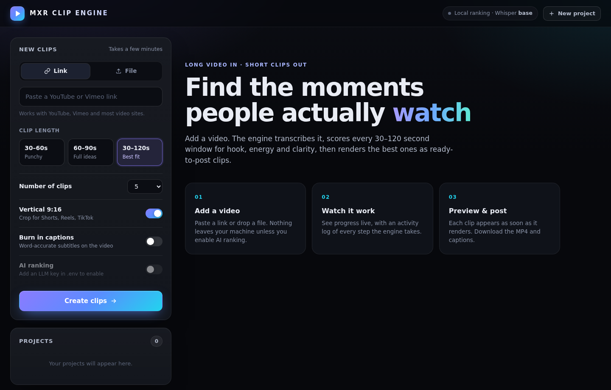
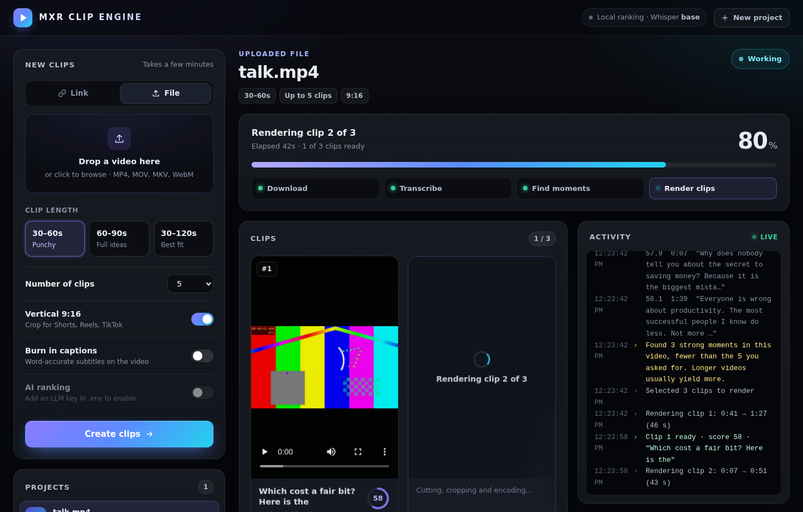

# MXR CLIP ENGINE

**Turn long videos into short clips people actually watch.**

MXR CLIP ENGINE runs on your own computer. Paste a YouTube or Vimeo link, or drop in a video file. It transcribes the speech, scores every 30 to 120 second window for hook strength, energy and clarity, then renders the best moments as 9:16 clips with optional captions. Each clip appears as soon as it's ready, and an activity log shows what the engine is doing at every step.





## Features

- **One-click start.** `python run.py` checks your setup and opens the app in your browser.
- **Live progress.** A progress bar, step tracker, and elapsed timer show where the job is.
- **Clips as they're made.** Each clip appears with a live preview as it finishes, with an estimated watch rate from worst to best.
- **Activity log.** A running, timestamped log of downloads, transcription, scoring, and rendering.
- **Engagement-first picking.** Clips are chosen by hook, energy, pace, completeness and length, with no overlaps.
- **Platform presets.** One 9:16 output sized for TikTok, YouTube Shorts or Instagram Reels, with caption margins that stay clear of each app's UI.
- **Quality, frame rate and aspect ratio.** Each has a Default / Custom switch. Default uses the quality preset (quick MP4 with an MP3, 4K at 30 fps, 60 fps, or 120 fps) and 9:16. Custom lets you pick a resolution (720p, 1080p, 1440p or 4K, measured on the short side), a frame rate (24, 25, 30, 50, 60 or 120 fps), and any aspect ratio from 2:5 to 5:2 (for example 4:5, 1:1 or 16:9). Clips are centre-cropped to the ratio.
- **Captions.** Word-timed captions with five styles (word highlight, classic, boxed, neon, minimal), top, middle or bottom placement, optional UPPERCASE and an accent colour. Each clip also gets an `.ass` caption file.
- **Projects menu.** The top-right **Projects** button opens Collections, New project (the clip form), and Clips (a library of every finished clip, with preview, download and add-to-collection).
- **Collections.** Group clips from any project into collections. Rename them, set a label, status (Draft, In review, Ready, Scheduled, Posted), notes, and order. Deleting a project removes its clips from collections.
- **Private by default.** Transcription runs locally with Whisper. Nothing is sent to the cloud unless you turn on AI ranking.
- **Optional AI picking.** Turn on AI ranking and the model reads the strongest candidate moments, keeps only the ones it would post itself (strong hook, clear payoff, makes sense on its own), and writes a title and reason for each.

## Requirements

- Python 3.10 or newer
- FFmpeg (video processing)
- About 2 GB of disk space for the speech model and temporary files
- A modern browser

## Install

### Windows

1. Install Python from [python.org](https://www.python.org/downloads/). Tick **Add Python to PATH**.
2. Install FFmpeg in a terminal: `winget install Gyan.FFmpeg`, then reopen the terminal.
3. Download or clone this repository, open a terminal in the folder, and run:
   ```bash
   pip install -r requirements.txt
   ```
4. Double-click **`run.bat`**, or run `python run.py`.

### macOS and Linux

```bash
# macOS
brew install ffmpeg
# Ubuntu / Debian
sudo apt install ffmpeg

git clone https://github.com/YOUR-USER/mxr-clip-engine.git
cd mxr-clip-engine
pip install -r requirements.txt
./run.sh          # or: python3 run.py
```

The app opens at **http://localhost:8000**. Press `Ctrl+C` in the terminal to stop it.

The first transcription downloads the Whisper speech model once. The default `base` model is about 150 MB.

## Configuration

Copy `.env.example` to `.env` and edit it. You don't need to change anything to get started.

| Variable | Default | What it does |
| --- | --- | --- |
| `WHISPER_MODEL` | `base` | Speech model: `tiny` (fastest), `base`, `small`, `medium`, `large-v3` (most accurate). |
| `WHISPER_BATCH_SIZE` | `8` | Speech windows decoded at once. Faster on a CPU. Set `1` if memory runs low. |
| `WHISPER_BEAM_SIZE` | `1` | `1` is fastest. `5` is more careful, but slower. |
| `WHISPER_THREADS` | all cores | CPU threads for speech recognition. |
| `WHISPER_DEVICE` | `auto` | Use `cuda` if you have an NVIDIA GPU. |
| `LLM_API_KEY` | empty | Enables AI ranking. Any OpenAI-compatible provider works. |
| `LLM_BASE_URL` | OpenAI | Change for OpenRouter, Groq, Ollama, or other providers. |
| `LLM_MODEL` | `gpt-4o-mini` | Model used for AI ranking. |
| `LLM_SHORTLIST` | `36` | How many candidate moments the AI reviews. More gives it more to choose from, at higher cost. |
| `MAX_DOWNLOAD_HEIGHT` | `1080` | Highest video resolution to download from links. |
| `CLIPPER_DATA_DIR` | `./data` | Where projects and clips are stored. |
| `PORT` | `8000` | Port to run on. |
| `HOST` | `127.0.0.1` | Set to `0.0.0.0` to open the app to other devices on your network. |
| `NO_BROWSER` | unset | Set to `1` to stop the browser from opening automatically. |

## What the scores mean

Two numbers appear on each clip, and neither is measured engagement:

- **Local score (0–100).** A heuristic from the signals below. It ranks clips against each other in this video only.
- **Estimated watch rate (0–100%).** The share of viewers you might expect to still be watching at the end of the clip, shown on a worst-to-best scale with a label (Weak, Fair, Good, Excellent). With AI ranking on, the model supplies this guess. With it off, the local score is shown instead, marked "Local estimate".

Neither is retention data from a platform. Treat them as a way to sort your options, then judge by watching.

## How the engine picks clips

It isn't a crystal ball. It uses signals that tend to hold attention in short-form video:

| Signal | Weight | What it looks for |
| --- | --- | --- |
| Hook | 28% | A question, a number, or a provocative word in the first five seconds, or a punchy opening line |
| Energy | 18% | Loudness compared with the rest of the video, and how much it varies |
| Completeness | 14% | Starts on a new sentence or after a pause, and ends on a finished thought |
| Emotional language | 12% | Density of charged words |
| Pace | 10% | A lively but clear speaking rate |
| Length | 10% | Sweet spot 45 to 90 seconds |
| Closure | 8% | A question that gets answered inside the clip |

Long silences and quiet stretches are penalised. With AI ranking on, the model reviews a wider set of moments (`LLM_SHORTLIST`), rejects weak ones, and the final score blends its view with the local score. Moments the AI rejects are never picked, and if it rejects everything the app says so and falls back to local scores. Weights live in `clipper/scoring.py` and are easy to tune.

Scores are a guide, not a guarantee. Real performance depends on your audience, topic and platform.

## Project layout

```
run.py / run.bat / run.sh   one-click launcher
clipper/
  config.py       settings (reads .env)
  download.py     video links via yt-dlp
  presets.py      platforms, quality levels, caption styles, rating bands
  captions.py     word-timed ASS captions
  collections_store.py  collections and their entries (JSON file)
  media.py        FFmpeg: audio, loudness, cutting, thumbnails, MP3
  transcribe.py   Whisper speech-to-text, grouped into sentences
  candidates.py   all valid 30–120 s windows
  scoring.py      engagement heuristics and overlap-free selection
  llm.py          optional AI ranking and titles
  pipeline.py     the whole job, reporting progress and log lines as it goes
  jobs.py         background worker, JSON persistence, live activity log
  server.py       FastAPI web app and API
static/           the web interface (HTML, CSS, JS, no build step)
tests/            unit tests
```

## API

The web app talks to a small JSON API, which you can also use from scripts.

| Method | Path | Purpose |
| --- | --- | --- |
| `POST` | `/api/jobs` | Start a project from a link (JSON body: `url`, `count`, `min_seconds`, `max_seconds`, `platform`, `quality`, `captions`, `caption_style`, `caption_position`, `caption_uppercase`, `caption_color`, `use_llm`) |
| `POST` | `/api/jobs/upload` | Start a project from an uploaded file (multipart form) |
| `GET` | `/api/jobs` | List projects |
| `GET` | `/api/jobs/{id}` | Project detail: progress, activity log, clips, warnings |
| `DELETE` | `/api/jobs/{id}` | Delete a finished project |
| `GET` | `/api/config` | Engine settings, presets and what's enabled |
| `GET` | `/api/clips` | Finished clips across projects (for adding to collections) |
| `GET`, `POST` | `/api/collections` | List or create collections |
| `GET`, `PATCH`, `DELETE` | `/api/collections/{id}` | Read, edit or delete a collection |
| `POST` | `/api/collections/{id}/entries` | Add a clip (`job_id`, `clip_id`) |
| `PATCH`, `DELETE` | `/api/collections/{id}/entries/{entry_id}` | Edit (title, status, note, label) or remove an entry |
| `POST` | `/api/collections/{id}/entries/{entry_id}/move` | Reorder (`direction`: `up` or `down`, or `to_index`) |

## Tests

```bash
pip install pytest numpy httpx
pytest -q
```

The tests cover word grouping, candidate boundaries, scoring, overlap-free selection, LLM response parsing, caption timing and styling, presets, watch-rate labels, collections, and project storage. The full pipeline has been run end to end on a test video, including through the browser.

## Limitations

- **Speed depends on your computer.** Transcription is the slowest step on a CPU. A GPU or a smaller model helps.
- **Scores are heuristics and guesses.** Local scores and AI watch-rate estimates approximate what holds attention. They don't predict results.
- **Crop is centred.** Talking-head footage works well. Wide or multi-speaker shots may need face tracking, which isn't included yet.
- **Upscaling.** A 9:16 crop from a 16:9 source is narrower than the output, so it is scaled up and looks softer. 4K output from a 1080p source adds file size, not detail. The app warns you when this happens.
- **Frame rate.** 60 and 120 fps exports from a 30 fps source repeat frames, so motion isn't smoother. Pick a higher frame-rate source for real gains.
- **Heavy renders need memory.** 4K and high-frame-rate renders can use several hundred MB of RAM per clip. On low-memory machines, use the quick preset.
- **Use content you have rights to.** Downloading from platforms may breach their terms. You are responsible for how you use the output.

## Contributing

Issues and pull requests are welcome. Please run `pytest -q` before submitting.

## License

MIT. See [LICENSE](LICENSE).
